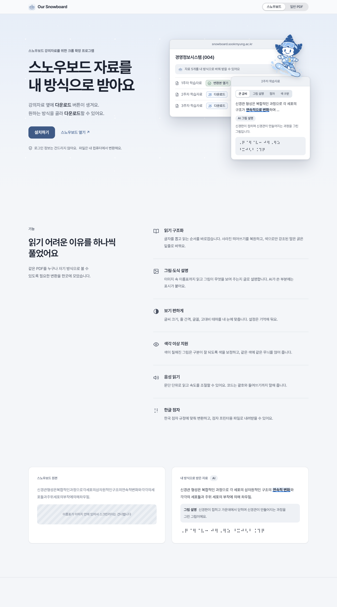
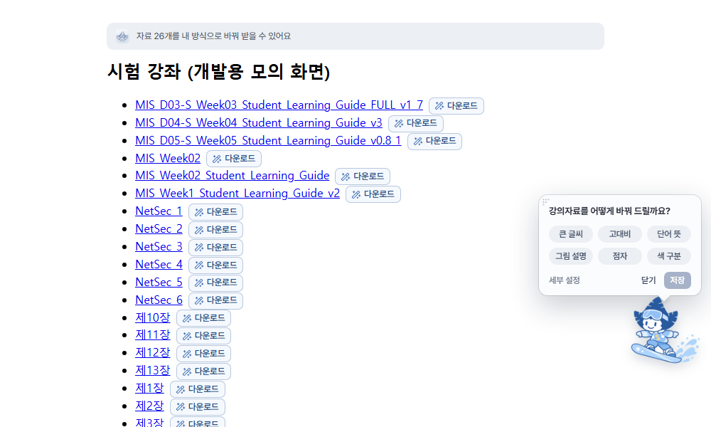
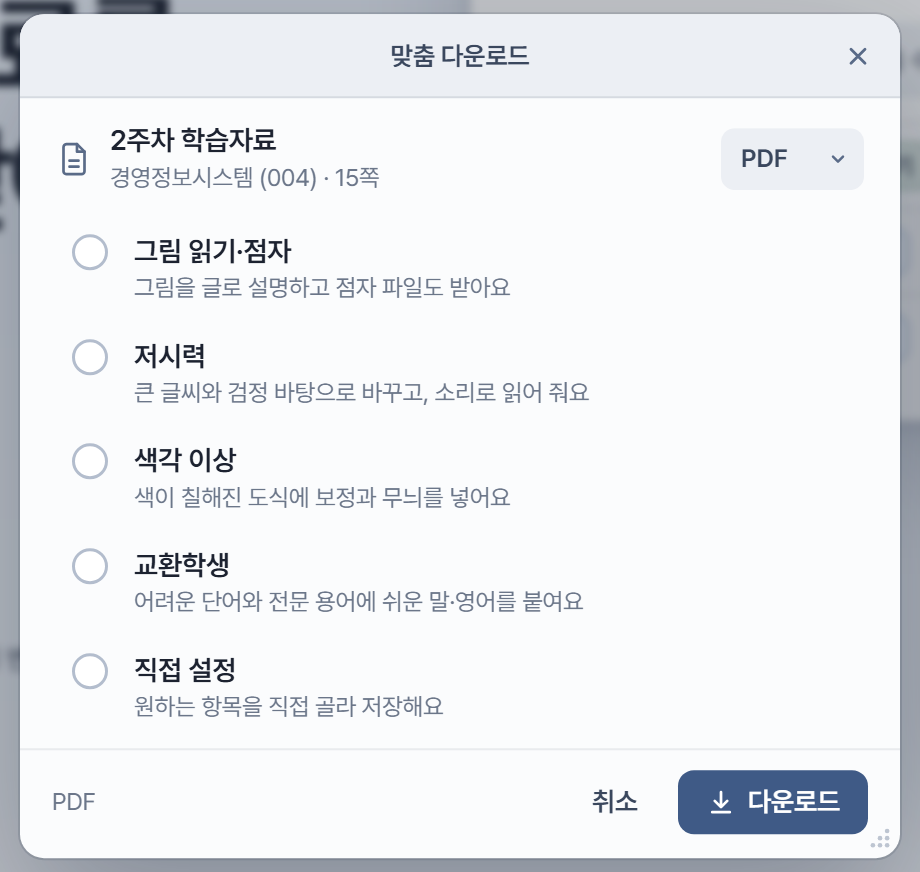
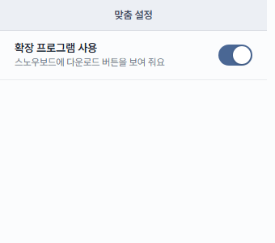
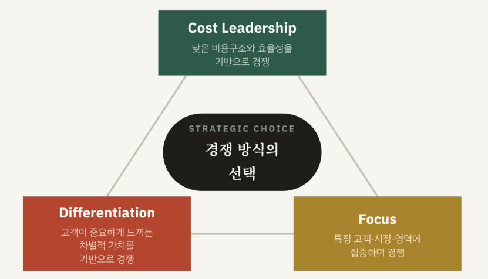
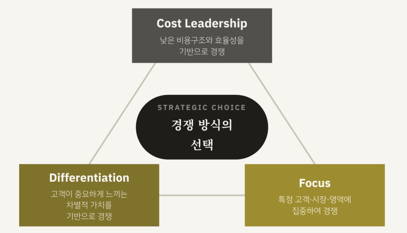
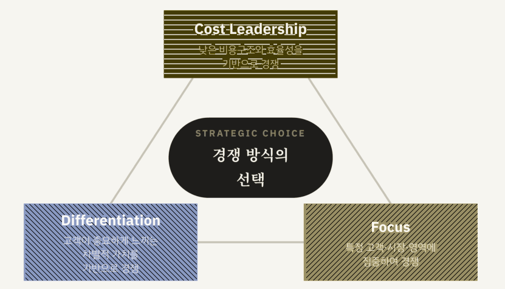
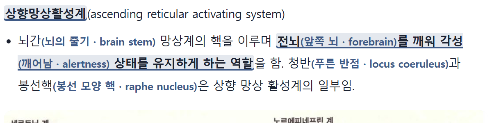
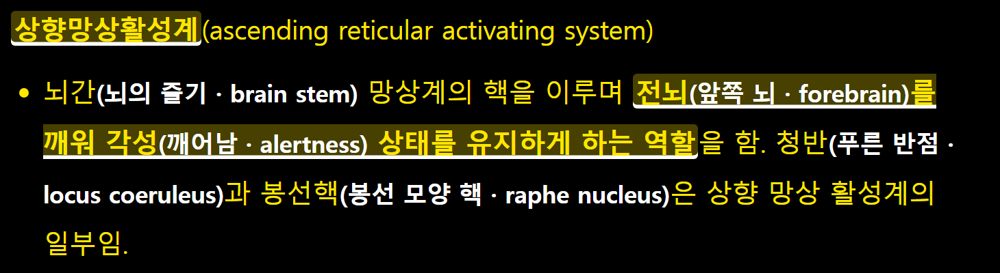
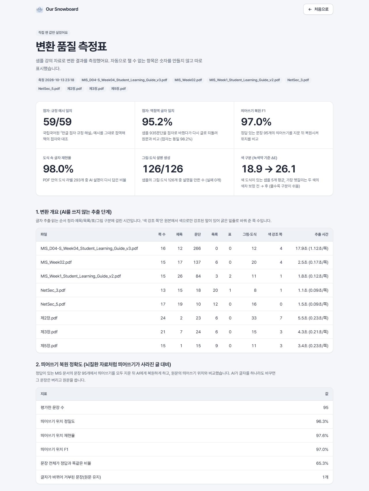

<!-- 위 머리말은 Hugging Face Spaces 배포용입니다. 자세한 배포 방법은 docs/DEPLOY.md -->

# Our Snowboard

> 모든 사람이 스노우보드를 잘 이용할 수 있도록.

숙명여대 스노우보드의 PDF 자료 옆에 **다운로드** 버튼이 생기는 크롬 확장 프로그램과, 내 컴퓨터에서 도는 변환 서버입니다.
버튼을 누르면 스노우보드 화면 위에 작은 창이 떠서, 변환 방식을 체크박스로 고르고 **다운로드**하면 바뀐 교재(원본 PDF에 접근성을 더한 파일, 선택하면 읽기용 PDF·웹 문서 `.html`, 선택하면 점자 `.brf`)가 내려옵니다. 새 탭이나 별도 웹사이트는 없습니다.

# Our Snowboard

> 모든 사람이 스노우보드를 잘 이용할 수 있도록.

숙명여대 스노우보드의 PDF 자료 옆에 **다운로드** 버튼이 생기는 크롬 확장 프로그램과, 내 컴퓨터에서 도는 변환 서버입니다.
버튼을 누르면 스노우보드 화면 위에 작은 창이 떠서, 필요한 방식을 고르고 **다운로드**하면 바뀐 교재(원본 PDF에 접근성을 더한 파일, 선택하면 읽기용 웹 문서 `.html`, 선택하면 점자 `.brf`)가 내려옵니다. 새 탭이나 별도 웹사이트는 없습니다.



## 왜 만들었나

같은 PDF인데 모두에게 읽히지는 않습니다.

- 그림 안의 이름표는 이미지 속 글자라 스크린리더가 건너뜁니다.
- 빨강·초록으로만 구분한 도식은 색각 이상이면 같은 색으로 보입니다.
- 빨간 글씨로만 한 강조는 색을 구분하지 못하면 사라집니다.
- 한국어 전문 용어는 외국인 학생에게 벽입니다.
- 점역에는 2주~한 달이 걸립니다 (뉴시스 2026.1).

스노우보드에서 학생이 직접 쓸 수 있는 변환 기능은 확인되지 않았습니다. Our Snowboard는 학교 서버를 고치지 않고 학생 쪽 브라우저에서 이 틈을 메웁니다. 특정 집단을 정하지 않고, 필요한 사람이 필요한 것만 골라 씁니다.

## 이렇게 씁니다

**1. 자료 옆에 버튼이 생깁니다.** 스노우보드 강의 화면의 PDF·PowerPoint 옆에 **다운로드** 버튼이, 위쪽에는 안내 띠가, 오른쪽 아래에는 마스코트와 함께 처음 쓸 때 방식을 정하는 작은 안내가 나타납니다. (개발용 모의 화면 `/mock?ext=1`)



**2. 필요한 방식을 고릅니다.** 버튼을 누르면 변환 창이 뜹니다. 방식은 프리셋 중에서 고르거나 **직접 설정**으로 항목을 하나씩 고릅니다. 받는 형식(PDF·웹 문서·점자)은 오른쪽 위에서 바꿉니다.



| 프리셋 | 하는 일 |
|---|---|
| 그림 읽기·점자 | 그림을 글로 설명하고 점자 파일(`.brf`)도 받음 (AI) |
| 저시력 | 큰 글씨와 검정 바탕으로 바꾸고, 소리 내어 읽어 줌 |
| 색각 이상 | 색이 칠해진 도식에 색 보정과 무늬를 넣음 |
| 교환학생 | 어려운 단어와 전문 용어에 쉬운 말·영어를 붙임 (AI) |
| 직접 설정 | 원하는 항목을 직접 골라 저장 |

툴바의 확장 아이콘을 누르면 서버 연결 상태를 볼 수 있습니다.



**3. 내려받습니다.** 체크한 항목만 처리해서 받습니다. 확장 프로그램 없이도 `http://localhost:8790` 에서 PDF를 직접 올릴 수 있습니다(보조 기능).

## 변환 결과 예시

**스크린리더가 건너뛰던 그림 속 글자를 글로 읽게 합니다.** 아래 그림은 "현대인의 뇌질환" 7장 강의자료 9쪽의 일부입니다. 이름표까지 이미지라서 그대로는 읽히지 않습니다.


변환하면 그림 자리에 이런 설명이 들어갑니다. (AI, 원본 PDF에서는 보이지 않는 글자 + 보충 쪽)

> 뇌의 세로토닌 계와 노르에피네프린 계 신경 경로를 나란히 비교한 그림입니다. 왼쪽의 세로토닌 계는 뇌간의 봉선핵(솔기핵)에서 시작해 신피질, 기저핵, 시상, 시상하부, 측두엽, 소뇌와 척수 등으로 뻗습니다. …

띄어쓰기가 사라진 글도 복원합니다: `신경관형성은복합적인과정으로…` → `신경관 형성은 복합적인 과정으로 …`

**색으로만 구분된 도식을 구분되게 바꿉니다.** 녹색약이 보는 원본에서는 두 색이 거의 같지만, 변환본은 색을 보정하고 같은 색에 같은 무늬를 얹습니다. (AI 없이 규칙으로 처리, 사진처럼 색이 번지는 그림은 건드리지 않음)

| 원본 | 녹색약이 보는 원본 | 녹색약이 보는 변환본 |
|---|---|---|
|  |  |  |

**어려운 말과 작은 글씨도 내 방식으로.** 읽기용 웹 문서는 어려운 단어 옆에 쉬운 뜻과 영어를 함께 보여 주고, 고대비·큰 글씨·소리 내어 읽기를 지원합니다.

| 웹 문서 | 고대비 |
|---|---|
|  |  |

**점자.** 한글 점자 `.brf`로 받아 점자 프린터에 출력할 수 있습니다. 예: `뇌간 망상계의 핵을 이루며 …` → `⠉⠽⠫⠒⠀⠑⠶⠇⠶⠈⠌⠺⠀⠚⠗⠁⠮ …` (다시 글로 되돌리면 원문과 일치)

## 품질은 숫자로 확인했습니다

샘플 강의자료 8개로 직접 재서 `http://localhost:8790/quality` 에 표로 보여 줍니다. 자동으로 잴 수 없는 항목은 숫자를 만들지 않고 따로 표시합니다.



| 항목 | 결과 |
|---|---|
| 점자: 규정 해설서 예시 | 59/59 일치 |
| 점자: 다시 글로 되돌려 원문과 비교 | 95.2% |
| 띄어쓰기 복원 F1 | 97.0% |
| 도식 속 글자 재현율 | 98.0% |
| 그림·도식 설명 생성 | 126/126 (실패 0) |
| 색 구분 (녹색약 기준 ΔE) | 18.9 → 26.1 |

## 실행하기

1. `.env.example` 을 `.env` 로 복사하고 `GATEWAY_API_KEY=` 뒤에 학교 AI API 키를 넣는다. (BAZE → API Gateway → API 키 생성. 키는 채팅·코드·커밋에 남기지 않는다.)
2. `start_server.bat` 더블클릭 (처음에는 `pip install -r server/requirements.txt`). 서버 주소는 `http://localhost:8790`.
3. 크롬 → `chrome://extensions` → 개발자 모드 → **압축해제된 확장 프로그램 로드** → `extension` 폴더 선택.
4. 스노우보드 강좌 화면의 PDF 옆에 **다운로드** 버튼이 생긴다. (확장 프로그램 없이도 `http://localhost:8790` 에서 PDF를 직접 올릴 수 있다. 보조 기능.)

## 지원하는 파일
PDF와 PowerPoint(.ppt, .pptx). PowerPoint는 서버가 먼저 PDF로 바꾼 뒤 PDF와 똑같이 처리한다(`server/convert_office.py`).
Windows에 PowerPoint가 있으면 그것으로, 없으면 LibreOffice(soffice)가 있을 때 그것으로 바꾼다. 둘 다 없으면 PPT는 변환할 수 없다고 안내한다.

## 변환 창에서 고르는 항목

핵심 원칙은 **원본 보존**이다. 강의에서 "8쪽 보세요"라고 하면 변환본에서도 8쪽이 같은 자리여야 하고, 그 위에 필기도 할 수 있어야 한다.
그래서 기본 결과물은 원본 PDF의 쪽 수·쪽 방향·배치·글자를 그대로 두고 접근성만 얹은 PDF다.

**받는 형식** (여러 개를 함께 고를 수 있다)

| 항목 | 설명 |
|---|---|
| PDF (기본) | 원본 쪽의 방향·배치·글자 그대로. 그림 자리에 보이지 않는 그림 설명 글자, 스캔된 쪽의 글자층, 제목 책갈피를 더하고, 맨 끝에 접근성 부록(그림 설명·쉬운 한국어·용어 사전)을 붙임. 점자를 고르면 `.brf`도 이 PDF 안에 첨부 |
| 웹 문서 | 같은 내용을 웹 문서(`.html`)로. 소리 내어 읽어 주기·글씨 크기 조절 도구가 들어 있음 |
| 점자 파일 | 한글 점자 `.brf` |

**넣을 것** (모든 형식에 들어간다)

| 항목 | AI | PDF에서는 | 웹 문서에서는 |
|---|---|---|---|
| 그림·도식을 글로 설명 | 사용 | 그림 자리의 숨은 글자 + 그 쪽 바로 뒤의 보충 쪽 | 그림 아래 설명 |
| 색 구분 돕기 | - | 도식을 같은 자리에서 보정+무늬로 교체 (사진·번지는 그림은 제외) | 같음 |
| 어려운 단어 뜻 | 사용 | 그 쪽 바로 뒤의 보충 쪽 | 본문이 쉬운 말로 바뀜 |
| 영어 용어 함께 | 사용 | 그 쪽 바로 뒤의 보충 쪽 | 용어 옆에 영어 병기 |
| 고대비 | - | 쪽 위에 색 반전 막(글자는 그대로 글자) | 검정 바탕 + 밝은 글씨 |

**웹 문서 설정** (웹 문서를 고를 때만): 큰 글씨로 읽기. 글자를 키우면 배치가 바뀌므로 원본 PDF에는 적용할 수 없고,
원본 PDF는 PDF 뷰어의 확대 기능과 함께 쓴다.

항상 들어가는 것: 읽는 순서 정리, 제목·목록·표·코드 구분, 띄어쓰기 복원(웹 문서·점자에 적용. 원본 PDF의 글자는 그대로 둔다), 스캔본(이미지 PDF)의 글자 읽기.
체크한 항목에서만 AI를 부르므로, AI 항목을 끄면 크레딧이 들지 않는다.

PDF에 글자를 더하려면 서버에 한글 글꼴이 필요하다(Windows는 맑은 고딕/나눔고딕, Linux는 `fonts-nanum`, macOS는 AppleGothic). 없으면 웹 문서로 대신 만든다.

## 구성

```
extension/     크롬 확장: 버튼·안내 띠(content.js), 변환 창(panel.js), 서버와의 통신·다운로드(background.js), 팝업
server/        FastAPI: extract(글자 추출) ops(필요한 AI 작업) render(결과 파일) braille_ko(점자) color(색 구분) enrich(AI 호출) llm jobs main
server/static/ 홈 화면, 품질 측정표, 변환 창(osb-panel.js), 스노우보드에 붙는 UI(osb-ui.css), 디자인 시스템(ds.css)
eval/          품질 측정 (python -m eval.run_eval → http://localhost:8790/quality), 서버 흐름 시험(e2e_api.py)
tools/         마스코트 이미지 만들기, 확장 프로그램 파일 동기화
docs/          화면 캡처 스크립트, 마스코트 원본
samples/ output/   (커밋 제외) 샘플 PDF와 변환 결과
```

흐름: `POST /api/prepare`(PDF 올리기: 글자 추출만, AI 없음) → `POST /api/jobs/{id}/make`(체크한 항목만 처리) → `GET /api/tasks/{id}`(진행) → `GET /api/tasks/{id}/file/{html|brf}`(받기).

## 시험

```
node extension/test_background.mjs     # 확장 프로그램 백그라운드의 올리기→변환→다운로드 흐름 (서버가 켜져 있어야 함)
python eval/e2e_api.py <PDF> [옵션JSON] # 서버의 전체 흐름
python -m eval.run_eval                # 변환 품질 측정표 (/quality)
python eval/test_pdf_out.py             # 원본 보존 PDF 시험 (원본 쪽 보존, 그림 설명 글자, 보충 쪽, 색 구분)
python docs/make_shots.py              # 화면 캡처 (Edge를 화면 없이 실행)
```

개발 중에는 `http://localhost:8790/mock?ext=1` 에서 확장 프로그램 없이 버튼과 창을 눌러 볼 수 있다 (`dev-bg.js` 가 가짜 chrome API 역할).

## 디자인

- 글꼴 **Pretendard Variable** (SIL OFL, 서버·확장에 포함). 맥(macOS) 느낌의 차분한 회청색 톤, 얇은 실선, 평평한 면. 색·부품은 `ds.css`, 스노우보드에 붙는 버튼·안내 띠는 `osb-ui.css`, 변환 창은 `osb-panel.js` 안에 있다.
- 디자인을 고친 뒤에는 `python tools/sync_ext.py` 로 확장 프로그램 폴더에도 복사한다.
- 마스코트는 `docs/mascot-src/` 원본에서 `python tools/make_mascot_assets.py` 로 만든다. 사이트 톤에 맞게 색을 조정해서 쓴다.

## AI 사용

- 기본 모델은 가장 저렴한 `gpt-6-luna` (실패하면 `gemini-3.5-flash-lite`). `.env` 의 `TEXT_MODEL` `VISION_MODEL` 로 바꾼다.
- 같은 입력은 `server/.cache/llm` 에 저장해서 다시 호출하지 않는다. 사용량: `http://localhost:8790/api/usage`.
- 이 서버는 내 크레딧을 쓰므로 `localhost` 외 접속과 허용하지 않은 웹사이트의 쓰기 요청은 거부한다.

## 점자 규정

한글 점자는 국립국어원 「한글 점자 규정 해설」(2017 개정 한국 점자 규정)의 예시 59개와 대조해 모두 일치하도록 구현했다. 수식·화학식 같은 전문 점자는 범위 밖이다.
