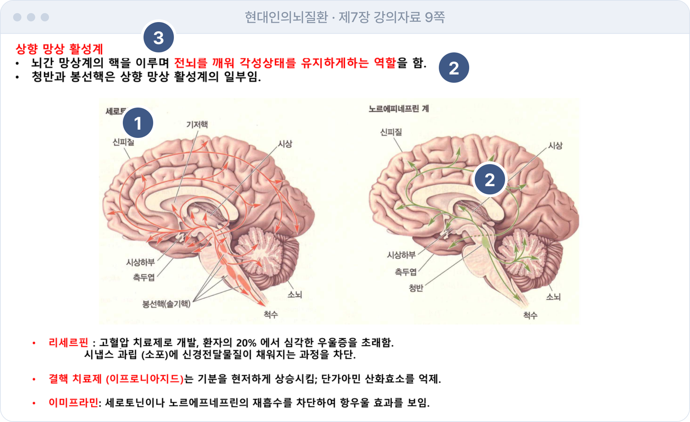
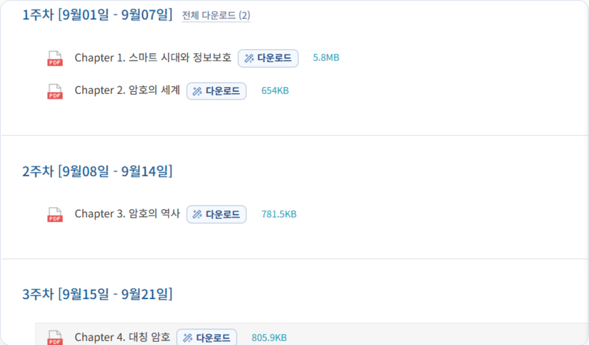
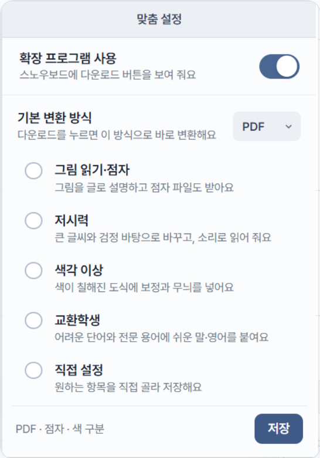
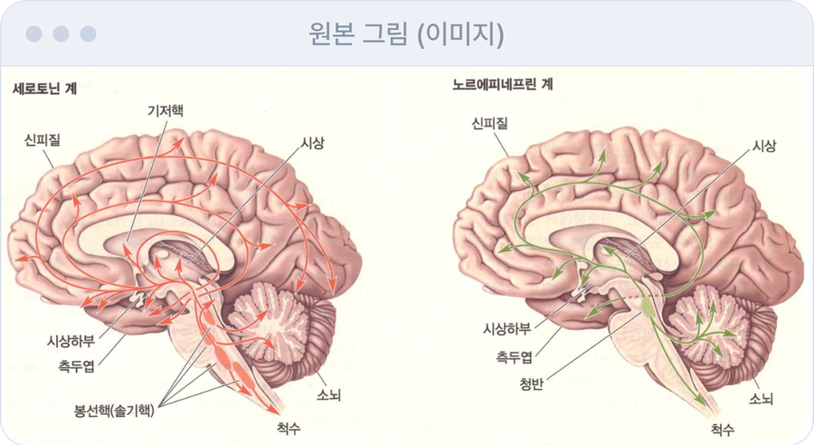
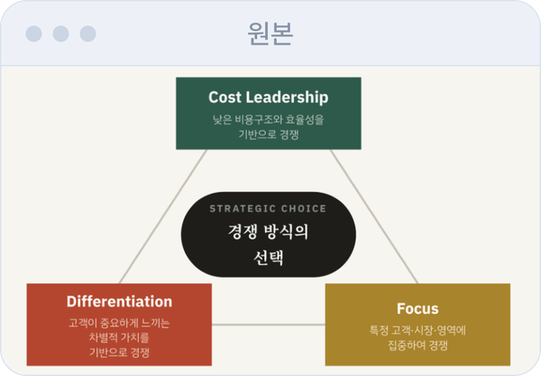
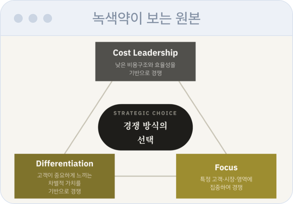
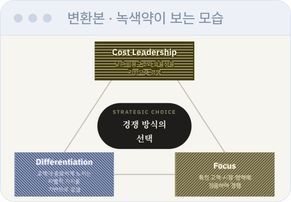
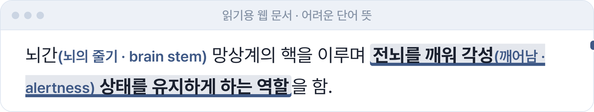

<!-- 위 머리말은 Hugging Face Spaces 배포용입니다. 자세한 배포 방법은 docs/DEPLOY.md -->

<p align="center">
  
</p>

# Our Snowboard

> 같은 강의자료를, 각자에게 편한 방식으로.

숙명여대 스노우보드의 PDF·PowerPoint 옆에 **다운로드** 버튼을 달아 주는 크롬 확장 프로그램과 변환 서버입니다.
버튼을 누르고 필요한 방식을 고르면, 원본은 그대로 두고 접근성을 더한 자료가 내려옵니다.
학교 시스템은 고치지 않습니다. 학생 쪽 브라우저에서만 동작합니다.

2026 SW MVP 경진대회 · 전하은 (소프트웨어학부 컴퓨터과학전공)


## 왜 만들었나

같은 PDF인데 모두에게 읽히지는 않습니다. (현대인의 뇌질환 · 제7장 강의자료 9쪽)



1. **그림 안의 이름표**: 이미지 속 글자라서 스크린리더가 건너뜁니다.
2. **색으로만 구분·강조**: 빨강·초록 경로와 빨간 글씨는 색각 이상이면 구분되지 않습니다.
3. **한국어 전문 용어**: 외국인 학생에게는 학습 장벽입니다.
4. **점자로 받을 수 없음**: 점역을 따로 기다려야 하고, 2주~한 달이 걸립니다 (뉴시스 2026.1).

## 어떻게 쓰나

**1. 자료 옆에 다운로드 버튼이 생깁니다.** 스노우보드 강의 화면의 자료마다 붙습니다.



**2. 필요한 방식을 고릅니다.** 마스코트의 안내에서 바로 고르거나, 확장 프로그램 설정에서 기본 변환 방식을 정해 둡니다.

| 마스코트에서 바로 선택 | 확장 프로그램 설정 |
|---|---|
|  |  |

**3. 다운로드합니다.** 체크한 항목만 처리해서 받습니다. 스노우보드 밖의 PDF·PPT도 홈페이지에서 올려 변환할 수 있습니다.

## 무엇이 달라지나

### 스크린리더가 건너뛰던 것을 읽게 합니다
그림 속 이름표까지 글로 읽히도록 AI가 그림 설명을 만들어 PDF에 넣습니다.



> 뇌의 세로토닌 계와 노르에피네프린 계 신경 경로를 나란히 비교한 그림입니다. 왼쪽의 세로토닌 계는 뇌간의 봉선핵(솔기핵)에서 시작해 신피질, 기저핵, 시상, 시상하부, 측두엽, 소뇌와 척수 등으로 뻗습니다. … (그림 속 글자 11개 함께 제공)

띄어쓰기가 사라진 글도 복원합니다.

| 원본에서 뽑은 글자 | 변환 후 |
|---|---|
| 신경관형성은복합적인과정으로각세포의삼차원적인구조의연속적변화와… | 신경관 형성은 복합적인 과정으로 각 세포의 삼차원적인 구조의 연속적 변화와 … |

### 점역을 기다리지 않고 점자 파일을 받습니다
한글 점자 `.brf` 파일로 변환하고, 점자를 다시 글로 되돌려 원문과 일치하는지 확인했습니다.

| 원문 | 점자 | 다시 글로 되돌림 |
|---|---|---|
| 뇌간 망상계의 핵을 이루며 전뇌를 깨워 각성 상태를 유지하게 하는 역할을 함. | ⠉⠽⠫⠒⠀⠑⠶⠇⠶⠈⠌⠺⠀⠚⠗⠁⠮ … | 뇌간 망상계의 핵을 이루며 전뇌를 깨워 각성 상태를 유지하게 하는 역할을 함. (일치) |

### 색으로만 구분된 도식을 구분되게 바꿉니다
색을 보정하고, 같은 색에는 같은 무늬를 얹습니다. AI 없이 규칙으로 처리하며, 사진처럼 색이 번지는 그림은 건드리지 않습니다.

| 원본 | 녹색약이 보는 원본 | 녹색약이 보는 변환본 |
|---|---|---|
|  |  |  |

Differentiation과 Focus가 거의 같은 색으로 보이던 것이, 변환 후에는 색과 무늬로 구분됩니다.

### 누구에게나 읽기 쉬운 자료로
같은 자료를 웹 문서로 받으면 큰 글씨·고대비, 소리 내어 읽기(‘읽어 주기’), 어려운 단어 뒤의 쉬운 말과 영어를 쓸 수 있습니다.




### 받는 형식과 항목

핵심 원칙은 **원본 보존**입니다. 강의에서 "8쪽 보세요"라고 하면 변환본에서도 8쪽이 같은 자리여야 하고, 필기도 할 수 있어야 하므로 기본 결과물은 원본 PDF의 쪽 수·방향·배치·글자를 그대로 두고 접근성만 얹은 PDF입니다.

| 형식 | 설명 |
|---|---|
| PDF (기본) | 원본 그대로. 그림 설명(숨은 글자), 스캔본의 글자층, 제목 책갈피, 보충 쪽, 점자 첨부 |
| 웹 문서 `.html` | 소리 내어 읽기, 글씨 크기 조절, 고대비, 쉬운 말 |
| 점자 `.brf` | 한글 점자 파일 |

| 프리셋 | 하는 일 | AI |
|---|---|---|
| 그림 읽기·점자 | 그림을 글로 설명하고 점자 파일도 받음 | 사용 |
| 저시력 | 큰 글씨와 검정 바탕, 소리로 읽어 줌 | - |
| 색각 이상 | 색이 칠해진 도식에 보정과 무늬 | - |
| 교환학생 | 어려운 단어와 전문 용어에 쉬운 말·영어 | 사용 |
| 직접 설정 | 원하는 항목을 직접 골라 저장 | - |

체크한 항목에서만 AI를 부르므로, AI 항목을 끄면 크레딧이 들지 않습니다. 지원 파일은 PDF와 PowerPoint(`.ppt` `.pptx`)이며, PowerPoint는 서버가 먼저 PDF로 바꿉니다(Windows는 PowerPoint, 없으면 LibreOffice 필요).

## 품질

실제 강의자료 8개로 변환 결과를 검증했습니다. 측정표는 서버를 켜고 `http://localhost:8790/quality` 에서 볼 수 있습니다.

| 항목 | 결과 | 어떻게 쟀나 |
|---|---|---|
| 띄어쓰기 복원 | F1 97.0% | 띄어쓰기를 모두 지운 문장 95개를 AI가 복원 → 원문과 비교 |
| 점자 · 규정 대조 | 59/59 일치 | 국립국어원 규정 해설서 예시 59개를 점역해 비교 |
| 점자 · 역점역 | 글자 95.2% · 점자 동일 98.2% | 점자를 다시 글로 되돌려 원문과 비교 (935문단) |
| 그림 속 글자 | 재현율 98.0% (287/293) | 도식 안 글자가 설명에 담기는 비율 |
| 색 구분 (녹색약) | ΔE 18.9 → 26.1 | 가장 비슷한 두 색의 색차 평균, 클수록 구분이 쉬움 (샘플 5개) |
| 글자 추출 속도 | 쪽당 평균 0.3초 | AI 없는 단계 (136쪽) |

구조: 스노우보드(수정하지 않음) → 크롬 확장(내 브라우저, Manifest V3) → 변환 서버(FastAPI · PyMuPDF) → AI API(`gpt-6-luna`).

## 시작하기

1. `.env.example` 을 `.env` 로 복사하고 `GATEWAY_API_KEY=` 뒤에 학교 AI API 키를 넣습니다. (BAZE → API Gateway → API 키 생성. 키는 채팅·코드·커밋에 남기지 않습니다.)
2. `start_server.bat` 을 실행합니다. 처음에는 `pip install -r server/requirements.txt`. 서버 주소는 `http://localhost:8790`.
3. 크롬 → `chrome://extensions` → 개발자 모드 → **압축해제된 확장 프로그램 로드** → `extension` 폴더 선택.
4. 스노우보드 강의 화면의 자료 옆에 **다운로드** 버튼이 생깁니다. 확장 프로그램 없이도 `http://localhost:8790` 에서 파일을 직접 올릴 수 있습니다.

인터넷에 올려서 쓰는 방법은 [docs/DEPLOY.md](docs/DEPLOY.md) 를 보세요.

<details>
<summary>개발자용 정보 (구조, 시험, 디자인, AI, 점자 규정)</summary>

### 구성

```
extension/     크롬 확장: 버튼·안내 띠(content.js), 변환 창(panel.js), 서버와의 통신·다운로드(background.js), 팝업
server/        FastAPI: extract(글자 추출) ops(필요한 AI 작업) render(결과 파일) braille_ko(점자) color(색 구분) enrich(AI 호출) llm jobs main
server/static/ 홈 화면, 품질 측정표, 변환 창(osb-panel.js), 스노우보드에 붙는 UI(osb-ui.css), 디자인 시스템(ds.css)
eval/          품질 측정 (python -m eval.run_eval → http://localhost:8790/quality), 서버 흐름 시험(e2e_api.py)
tools/         마스코트 이미지 만들기, 확장 프로그램 파일 동기화
docs/          화면 캡처 스크립트, 마스코트 원본
samples/ output/   (커밋 제외) 샘플 PDF와 변환 결과
```

흐름: `POST /api/prepare`(PDF 올리기: 글자 추출만, AI 없음) → `POST /api/jobs/{id}/make`(체크한 항목만 처리) → `GET /api/tasks/{id}`(진행) → `GET /api/tasks/{id}/file/{html|brf}`(받기).

### 시험

```
node extension/test_background.mjs     # 확장 프로그램 백그라운드의 올리기→변환→다운로드 흐름 (서버가 켜져 있어야 함)
python eval/e2e_api.py <PDF> [옵션JSON] # 서버의 전체 흐름
python -m eval.run_eval                # 변환 품질 측정표 (/quality)
python eval/test_pdf_out.py             # 원본 보존 PDF 시험 (원본 쪽 보존, 그림 설명 글자, 보충 쪽, 색 구분)
python docs/make_shots.py              # 화면 캡처 (Edge를 화면 없이 실행)
```

개발 중에는 `http://localhost:8790/mock?ext=1` 에서 확장 프로그램 없이 버튼과 창을 눌러 볼 수 있다 (`dev-bg.js` 가 가짜 chrome API 역할).

### 디자인

- 글꼴 **Pretendard Variable** (SIL OFL, 서버·확장에 포함). 맥(macOS) 느낌의 차분한 회청색 톤, 얇은 실선, 평평한 면. 색·부품은 `ds.css`, 스노우보드에 붙는 버튼·안내 띠는 `osb-ui.css`, 변환 창은 `osb-panel.js` 안에 있다.
- 디자인을 고친 뒤에는 `python tools/sync_ext.py` 로 확장 프로그램 폴더에도 복사한다.
- 마스코트는 `docs/mascot-src/` 원본에서 `python tools/make_mascot_assets.py` 로 만든다. 사이트 톤에 맞게 색을 조정해서 쓴다.

### AI 사용

- 기본 모델은 가장 저렴한 `gpt-6-luna` (실패하면 `gemini-3.5-flash-lite`). `.env` 의 `TEXT_MODEL` `VISION_MODEL` 로 바꾼다.
- 같은 입력은 `server/.cache/llm` 에 저장해서 다시 호출하지 않는다. 사용량: `http://localhost:8790/api/usage`.
- 이 서버는 내 크레딧을 쓰므로 `localhost` 외 접속과 허용하지 않은 웹사이트의 쓰기 요청은 거부한다.

### 점자 규정

한글 점자는 국립국어원 「한글 점자 규정 해설」(2017 개정 한국 점자 규정)의 예시 59개와 대조해 모두 일치하도록 구현했다. 수식·화학식 같은 전문 점자는 범위 밖이다.

</details>
