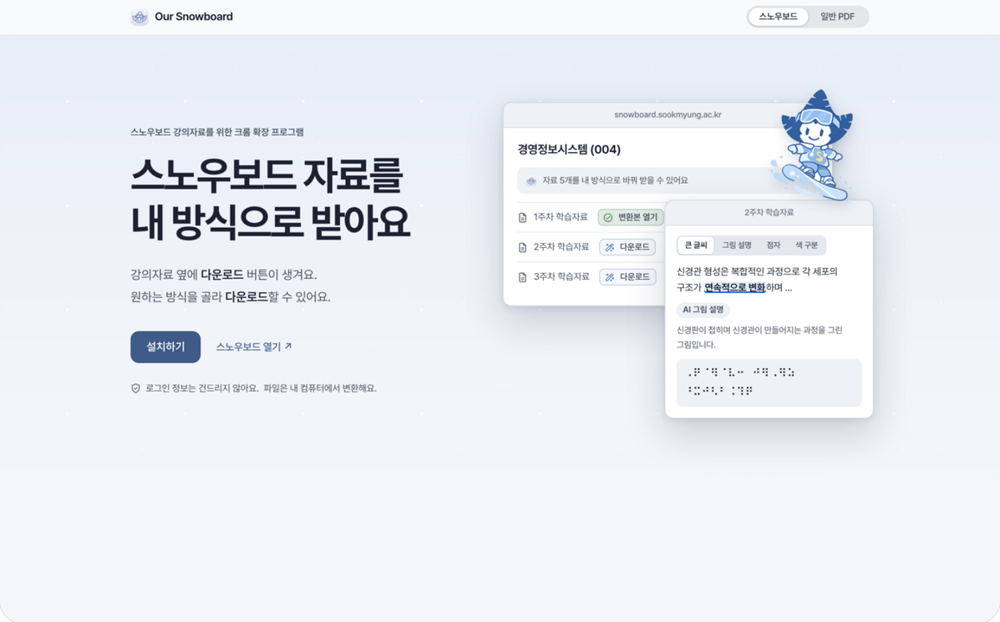
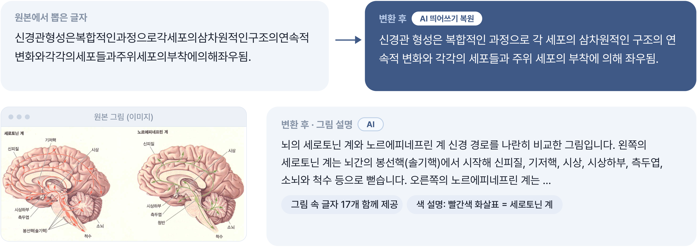
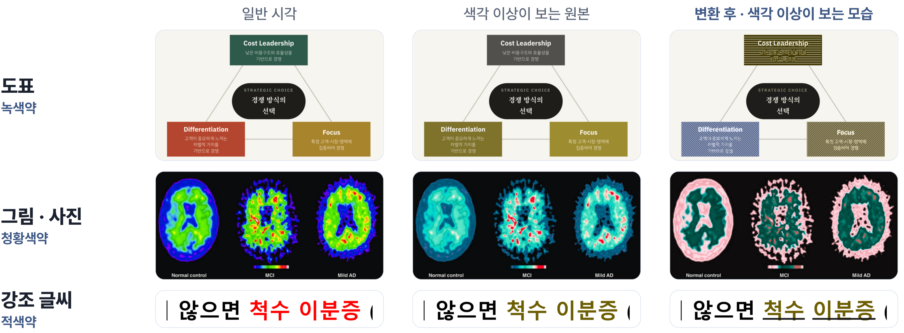
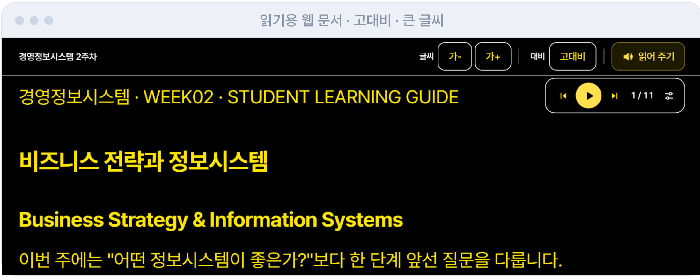
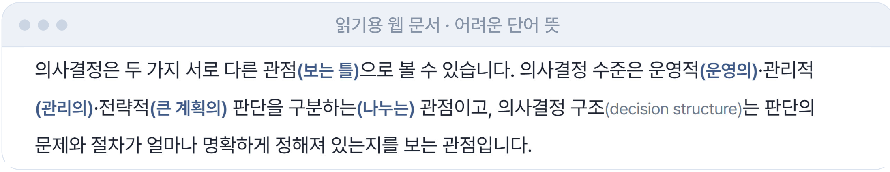

<div align="center">

# 🏂 Our Snowboard

**같은 강의자료를, 각자에게 편한 방식으로.**

숙명여대 스노우보드의 PDF·PowerPoint 옆에 **다운로드** 버튼을 달아 주는 크롬 확장 프로그램입니다.<br>
필요한 방식을 고르면 원본은 그대로 두고, 접근성을 더한 자료가 내려옵니다.



</div>

<br>

| 📄 샘플 강의자료 | ✅ 변환 성공 | 🔤 점자 규정 예시 | 🖼️ 그림 속 글자 재현 | 💰 자료 한 건 AI 비용 |
|:---:|:---:|:---:|:---:|:---:|
| **24개** (475쪽) | **24 / 24** | **59 / 59** 일치 | **96.4%** | **약 16~34원** |

<br>

## 왜 만들었나

같은 PDF인데 모두에게 읽히지는 않습니다.


1. **그림 안의 이름표** — 이미지 속 글자라서 스크린리더가 건너뜁니다.
2. **색으로만 구분·강조** — 빨강·초록 경로와 빨간 글씨는 색각 이상이면 구분되지 않습니다.
3. **한국어 전문 용어** — 외국인 학생에게는 학습 장벽입니다.
4. **점자로 받을 수 없음** — 점역을 따로 기다려야 하고, 빨라야 2주에서 개강기엔 한 달 이상 걸립니다.

샘플 강의자료 24개를 점검했더니 그림에 설명이 제대로 달린 자료는 하나도 없었습니다.

| 누가 불편한가 | 만든 기능 |
|---|---|
| 시각장애 · 스크린리더 | 읽는 순서 정리 · 그림 설명 · 스캔본 글자 읽기 · 구조 태그 |
| 시각장애 · 점자 | 한글 점자 `.brf` 변환 |
| 색각 이상 | 색 보정 · 같은 색에 같은 무늬 · 강조 글씨 밑줄 |
| 저시력 | 큰 글씨 · 고대비 |
| 외국인 학생 | 어려운 단어에 쉬운 말·영어 |
| 모든 학생 | 소리 내어 읽기 (AI 목소리 4종) |

<br>

## 이렇게 씁니다

확장 프로그램만 켜면 됩니다. 학교 시스템은 건드리지 않습니다.

**① 자료 옆에 다운로드 버튼이 생깁니다.** 주차별로 한꺼번에 받을 수도 있습니다.


**② 필요한 방식을 고릅니다.** 마스코트에게 바로 고르거나, 설정에서 기본 방식을 정해 둡니다.

<table>
<tr>
<td align="center"><b>마스코트에서 바로 선택</b></td>
<td align="center"><b>확장 프로그램 설정</b></td>
</tr>
<tr>
<td align="center"></td>
<td align="center"></td>
</tr>
</table>

**③ 다운로드합니다.** 체크한 항목만 처리하고, 파일 이름에 고른 기능이 표시됩니다. 스노우보드 밖의 PDF·PPT도 홈페이지에서 올려 변환할 수 있습니다.

<br>

## 무엇이 달라지나

### 👁️ 스크린리더가 건너뛰던 것을 읽게 합니다

AI가 그림 설명을 만들어 PDF에 넣고, 그림 속 글자를 빠뜨리면 스스로 점검해 다시 씁니다. 띄어쓰기가 사라진 글도 복원합니다.



- 제목·목록·읽는 순서를 담은 **구조 태그 PDF**를 만들고, 그림 설명을 그림의 대체 텍스트로 넣습니다.
- 스캔본에는 글자층을, 제목에는 책갈피를 답니다.
- AI가 글자를 하나라도 바꾸면 그 문장은 버리고 원문을 씁니다.

### ⠿ 점역을 기다리지 않고 점자 파일을 받습니다

한글 점자 `.brf`로 바꾸고, 점자를 다시 글로 되돌려 원문과 일치하는지 확인했습니다. 수식·기호도 점역합니다.

| 원문 | 점자 | 다시 글로 되돌림 |
|---|---|---|
| 뇌간 망상계의 핵을 이루며 전뇌를 깨워 각성 상태를 유지하게 하는 역할을 함. | ⠉⠽⠫⠒⠀⠑⠶⠇⠶⠈⠌⠺⠀⠚⠗⠁⠮ … | 뇌간 망상계의 핵을 이루며 전뇌를 깨워 각성 상태를 유지하게 하는 역할을 함. ✔ 일치 |

### 🎨 색으로만 구분된 것을 구분되게 바꿉니다

색을 보정하고 같은 색에는 같은 무늬를 얹습니다. 빨간 글씨는 밑줄로 강조합니다. 녹색약·적색약·청황색약을 모두 지원하고, AI 없이 규칙으로 처리합니다.



### 📖 누구에게나 읽기 쉬운 자료로

웹 문서로 받으면 큰 글씨, 고대비, **소리 내어 읽기**, 어려운 단어 뒤의 쉬운 말과 영어를 쓸 수 있습니다.





- 읽어 주기 버튼 아래의 작은 플레이어에서 이전/다음, 배속, 진행 표시를 쓰고 AI 목소리 4종 중에서 고릅니다.
- 목소리를 바꿔도 멈추지 않고, 새 목소리가 준비되면 이어서 바꿔 끼웁니다.
- 고른 기능만 도구 막대에 보이고, 글꼴(Pretendard)을 내장해 어디서 열어도 같게 보입니다.

<br>

## 받는 형식과 프리셋

| 형식 | 담기는 것 |
|---|---|
| **PDF** (기본) | 원본 그대로 + 그림 설명 · 구조 태그 · 스캔본 글자층 · 제목 책갈피 · 보충 쪽 · 점자 첨부 |
| **웹 문서** `.html` | 소리 내어 읽기 · 글씨 크기 · 고대비 · 쉬운 말 |
| **점자** `.brf` | 한글 점자 파일 |

| 프리셋 | 하는 일 | AI |
|---|---|:---:|
| 그림 읽기·점자 | 그림을 글로 설명하고 점자 파일도 받음 | ✔ |
| 저시력 | 큰 글씨와 검정 바탕, 소리로 읽어 줌 | |
| 색각 이상 | 색이 칠해진 도식에 보정과 무늬 | |
| 교환학생 | 어려운 단어와 전문 용어에 쉬운 말·영어 | ✔ |
| 직접 설정 | 원하는 항목을 직접 골라 저장 | |

체크한 항목에서만 AI를 부르므로, AI 항목을 끄면 크레딧이 들지 않습니다. 지원 파일은 PDF와 PPT입니다.

<br>

## 얼마나 믿을 수 있나

실제 강의자료(법학·생물·의학·경영/보안)로, 세 가지 방법을 써서 확인했습니다.

| | 항목 | 결과 | 어떻게 쟀나 |
|---|---|---|---|
| **정답과 대조** | 점자 규정 | **59 / 59** 일치 | 국립국어원 규정 해설서 예시를 점역해 비교 |
| | 띄어쓰기 복원 | **F1 97.0%** | 띄어쓰기를 지운 문장 95개를 복원해 원문과 비교 (Kiwi만 쓰면 93.1%) |
| | 전공 용어 영어 병기 | **34 / 36** | 직접 만든 용어 정답지 (과목 정보를 빼면 30/36) |
| **되돌려 비교** | 점자 역점역 | 글자 **97.8%** · 점자 **99.5%** | 점자를 글로 되돌려 원문과 비교 (3,455문단) |
| | 점역 못 해 빠지던 글자 | **1,395 → 0** | 기호 점역을 더하기 전 → 후 |
| **따로 확인** | 그림 설명 | **126 / 126** 생성 | 샘플의 그림·도식 126개, 실패 0 |
| | 그림 속 글자 재현율 | **91.0% → 96.4%** | 라벨 3개 이상인 그림 103개, 첫 시도 → 자기검증 후 |
| | 색 구분 (ΔE) | **25.9 → 32.1** | 가장 비슷한 두 색의 색차 평균, 클수록 구분이 쉬움 |


<br>

<br>

## 직접 실행해 보기

```bash
pip install -r server/requirements.txt
cp .env.example .env        # GATEWAY_API_KEY 에 학교 AI API 키를 넣는다
python -m uvicorn server.main:app --host 127.0.0.1 --port 8790
```

1. 크롬 `chrome://extensions` → 개발자 모드 → **압축해제된 확장 프로그램을 로드** → `extension/` 선택
2. 스노우보드 강의 화면에서 자료 옆 버튼을 누릅니다. (계정 없이 해 보려면 http://localhost:8790/mock)

AI 키가 없어도 저시력·색각 이상 프리셋과 점자 변환은 쓸 수 있습니다.
